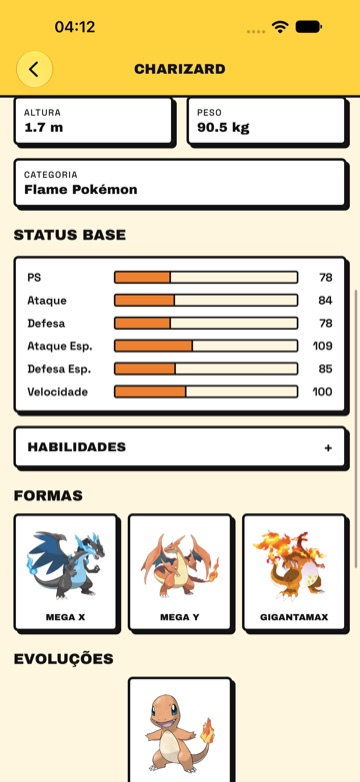
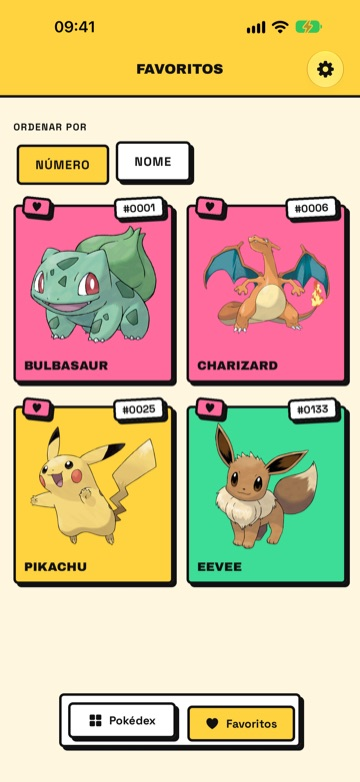
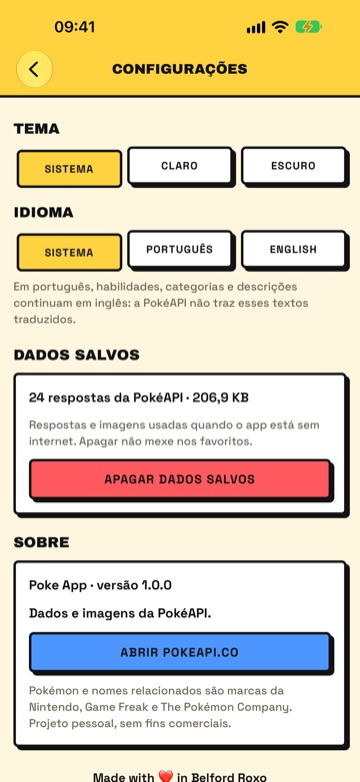
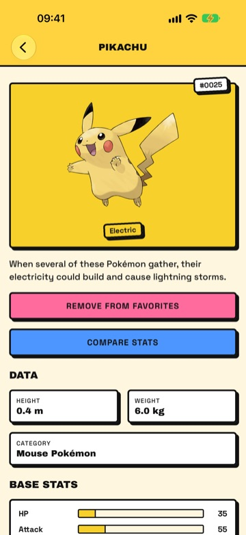
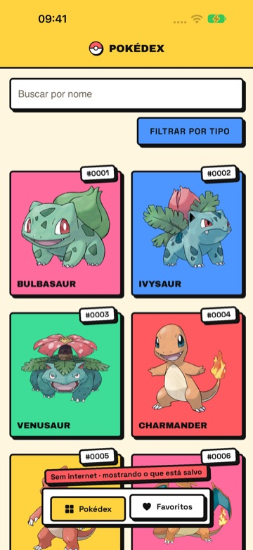

<div align="center">


# ⚡ Poke App

**Uma Pokédex para iOS e Android, no estilo neo-brutalista.**
Bordas grossas, sombras duras e cores chapadas, com os dados da [PokéAPI](https://pokeapi.co/).


</div>

## 📸 Telas

<table>
  <tr>
    <td align="center"><br><sub><b>Pokédex</b></sub></td>
    <td align="center"><br><sub><b>Busca e filtro por tipo</b></sub></td>
    <td align="center"><br><sub><b>Detalhes</b></sub></td>
  </tr>
  <tr>
    <td align="center"><br><sub><b>Formas</b></sub></td>
    <td align="center"><br><sub><b>Linha evolutiva</b></sub></td>
    <td align="center"><br><sub><b>Comparar status</b></sub></td>
  </tr>
  <tr>
    <td align="center"><br><sub><b>Favoritos</b></sub></td>
    <td align="center"><br><sub><b>Configurações</b></sub></td>
    <td align="center"><br><sub><b>Em inglês</b></sub></td>
  </tr>
  <tr>
    <td align="center"><br><sub><b>Tema escuro</b></sub></td>
    <td align="center"><br><sub><b>Sem internet</b></sub></td>
    <td align="center"><br><sub><b>Splash</b></sub></td>
  </tr>
</table>

## ✨ O que o app faz

- 📖 **Pokédex** em grade com as 1.025 espécies, carregada de 30 em 30 enquanto você rola. Puxar para baixo recarrega.
- 🔎 **Busca por nome ou número** (`25` ou `#0025`) e 🏷️ **filtro por tipo**, numa folha que sobe da parte de baixo da tela. Os dois funcionam juntos.
- 📊 **Detalhes** com arte oficial (e a versão ✨ shiny num toque), 🔊 grito do Pokémon, tipos, descrição, altura e peso, status base em barras, habilidades e 🥊 **golpes** do jogo mais recente em que o Pokémon aparece, separados por nível, MT, ovo e tutor.
- 🛡️ **Fraquezas e resistências** nos detalhes: o dano que cada tipo de golpe causa (4×, 2×, ½×, ¼× e imunidade), somando os dois tipos do Pokémon. Vem de uma tabela no app, então funciona sem internet.
- 🧬 **Linha evolutiva** com o que faz cada etapa evoluir (Nv. 16, Pedra da Água, Troca…).
- 🎭 **Formas** de cada Pokémon nos detalhes: megaevoluções, formas regionais e Gigantamax, cada uma com tipos e status próprios.
- ⚔️ **Comparar status**: escolha um adversário e veja os dois lado a lado, com o total.
- ❤️ **Favoritos** em aba própria, ordenáveis por número ou nome e salvos no aparelho.
- 🇧🇷 **Português e inglês**: a interface inteira nos dois idiomas. Em português, tipos e itens também são traduzidos (Fogo, Água, Pedra do Trovão…).
- 🌗 **Tema claro e escuro**, seguindo o sistema ou escolhido pelo usuário.
- ⚙️ **Configurações** na engrenagem do cabeçalho: tema e idioma (Sistema, ou um fixo), quanto ocupa a cópia offline com um botão para apagar, e a tela Sobre.
- 📴 **Funciona sem internet** com o que já foi aberto: cada resposta da PokéAPI fica salva no aparelho e é usada quando falta rede. Um adesivo acima das abas avisa que o app está sem internet.

## 🧰 Tecnologias

| | |
| --- | --- |
| 📱 App | Expo SDK 58 · React Native 0.88 · Expo Router (rotas em `src/app/`) |
| 🗃️ Estado e dados | Redux Toolkit 2 · RTK Query para a PokéAPI · slices para os favoritos e as configurações |
| 🌐 Idiomas | `i18next` + `react-i18next` com chaves tipadas · `expo-localization` para o idioma do aparelho |
| 🧩 Componentes nativos | `@expo/ui` no campo de busca e na folha de tipos |
| 💾 Persistência | `expo-sqlite/kv-store` para os favoritos e as respostas da PokéAPI (modo sem internet) · `expo-network` para saber se há conexão |
| 🔊 Áudio | `expo-audio` para os gritos, em MP3 do Pokémon Showdown (os `.ogg` da PokéAPI não tocam no iOS) |
| 🔤 Fontes | Archivo Black e Space Grotesk |
| 🧪 Qualidade | ESLint + Prettier · TypeScript · Jest (unitários) · Maestro (E2E) · Reactotron (depuração) |

## 🚀 Rodar

O projeto usa **yarn** (há um `yarn.lock`).

```bash
yarn install
yarn expo start
```

No terminal do Expo, aperte `i` para o simulador do iOS ou `a` para o emulador Android. Roda direto no **Expo Go**, sem development build.

🔍 **Reactotron (opcional):** abra o app de desktop [Reactotron](https://github.com/infinitered/reactotron/releases) antes do `yarn expo start` para ver as actions do Redux, o estado da store, as requisições à PokéAPI e os `console.log`. Ele só é carregado em desenvolvimento e se conecta sozinho, no simulador, no emulador ou no celular.

## 📦 Gerar um APK

O build usa o [EAS](https://docs.expo.dev/build/introduction/), configurado em `eas.json`. O perfil `preview` gera um **APK** para instalar direto no emulador ou no celular (o `production` gera o `.aab` da Play Store). Com `--local`, o build roda na sua máquina:

```bash
npx eas-cli@latest build -p android --profile preview --local
```

Para instalar no emulador, arraste o `.apk` para a janela dele ou use `adb install -r arquivo.apk`. O identificador do app é `com.fabio.dev.pokeapp`, no Android e no iOS. Os arquivos gerados (`.apk`, `.aab`, `.ipa`) ficam fora do git. O app abre no idioma do aparelho; dá para fixar português ou inglês nas Configurações.

Se o Android disser que **ocorreu um problema ao instalar o pacote**:

- desinstale a versão anterior: o Android não atualiza um app assinado com outra chave nem volta para um `versionCode` menor;
- confira se o arquivo chegou inteiro (o tamanho tem que bater com o do Mac): envios por mensagem ou nuvem às vezes cortam o APK;
- permita "Instalar apps desconhecidos" para o app que abriu o arquivo (Arquivos, Chrome, Drive).

Pelo cabo, com a depuração USB ligada, o `adb install -r arquivo.apk` mostra o motivo exato.

## ✅ Antes de terminar uma mudança

```bash
yarn lint          # ESLint + Prettier
npx tsc --noEmit   # typecheck
yarn test          # testes unitários (Jest, cerca de 1 s)
```

## 🧪 Testes

**Unitários (Jest):** ficam em [`__tests__/`](__tests__) e cobrem as regras sem tela: nomes e rótulos das formas, fraquezas e resistências, golpes, busca, linha evolutiva, traduções nos dois idiomas, escolha do idioma, favoritos e a cópia offline das respostas. Rodam em cerca de 1 segundo com `yarn test`.

**Ponta a ponta (Maestro):** usam o [Maestro](https://maestro.dev/) e ficam em [`.maestro/`](.maestro/README.md). Lá também estão o fluxo 📴 sem internet (`.maestro/offline/`, que roda à parte) e o script 🎬 que grava o vídeo de demonstração no simulador do iOS.

```bash
maestro test -e APP_ID=host.exp.Exponent -e EXPO_URL=exp://127.0.0.1:8081 .maestro
```

## 🗂️ Estrutura

```
src/
├─ app/            telas e navegação (Expo Router)
│  ├─ (tabs)/      abas Pokédex e Favoritos
│  ├─ pokemon/     detalhes: /pokemon/pikachu
│  ├─ compare.tsx  comparação: /compare?a=pikachu&b=raichu
│  └─ settings.tsx configurações: tema, idioma, dados salvos e sobre
├─ components/     peças visuais (BrutalBox, PokemonCard, SearchBar…)
├─ constants/      tokens do estilo e cores dos tipos
├─ features/
│  ├─ pokemon/     cliente da PokéAPI, cópia offline das respostas, traduções e funções de apoio
│  ├─ favorites/   slice e persistência dos favoritos
│  └─ settings/    slice, persistência e aplicação do tema e do idioma
├─ hooks/          tema, idioma, cabeçalho e conexão com a internet
├─ i18n/           textos da interface em português e inglês
└─ store/          store do Redux, hooks tipados e Reactotron
```

## 📝 Observações

- 🇬🇧 A PokéAPI não traz textos em português. Tipos, itens e gatilhos de evolução são traduzidos por uma tabela no app (`translations.ts`); descrições, categorias, habilidades e golpes continuam em inglês. Em inglês, tudo vem da própria API.
- 🔢 Como na PokéAPI, a Pokédex, a busca e o filtro mostram só as 1.025 espécies. As 326 formas alternativas (megas, regionais, Gigantamax…) aparecem na seção Formas dos detalhes de cada espécie.
- 🌐 O app foi testado no iOS e no Android. A versão web não foi testada.

<div align="center">
<sub>Dados e imagens: <a href="https://pokeapi.co/">PokéAPI</a>. Gritos: <a href="https://play.pokemonshowdown.com/">Pokémon Showdown</a>. Pokémon e nomes relacionados são marcas da Nintendo, Game Freak e The Pokémon Company; este é um projeto pessoal, sem fins comerciais.</sub>
</div>
