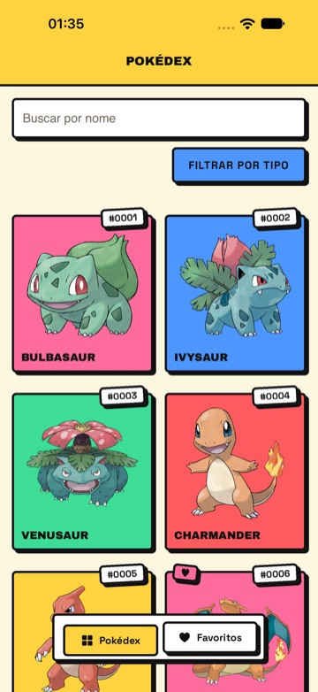
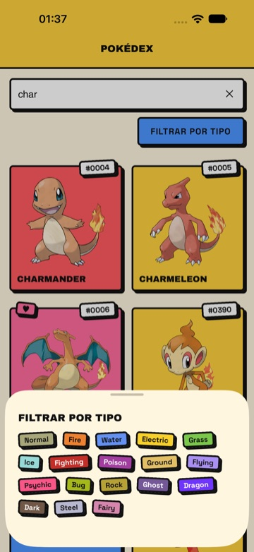
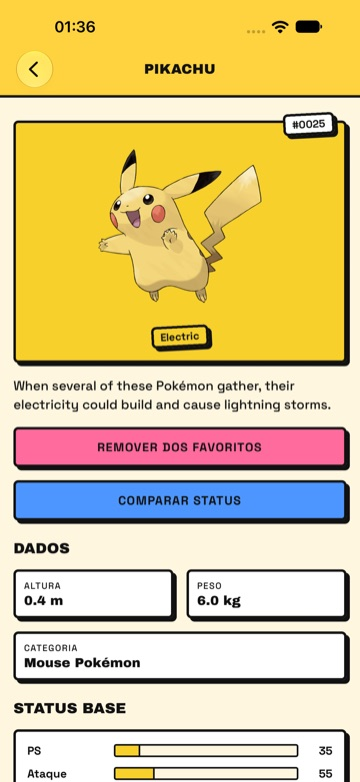
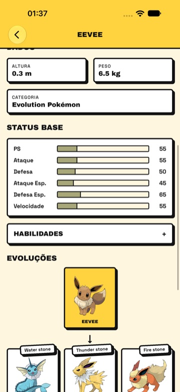
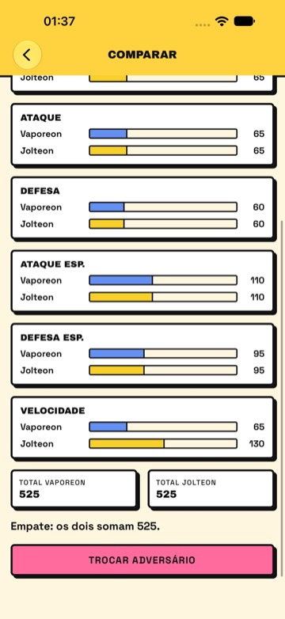
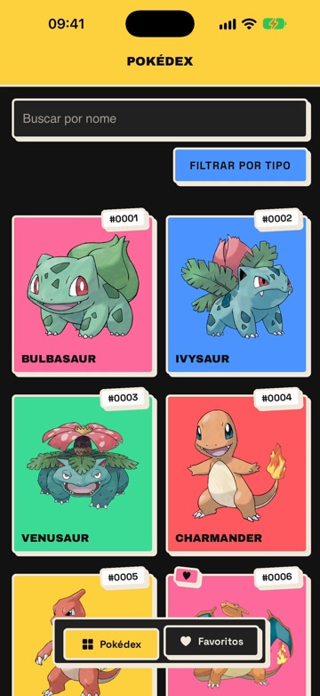

<div align="center">

# ⚡ Poke App

**Uma Pokédex para iOS e Android, no estilo neo-brutalista.**
Bordas grossas, sombras duras e cores chapadas, com os dados da [PokéAPI](https://pokeapi.co/).


</div>

## 📸 Telas

<table>
  <tr>
    <td align="center"><br><sub><b>Pokédex</b></sub></td>
    <td align="center"><br><sub><b>Busca e filtro por tipo</b></sub></td>
    <td align="center"><br><sub><b>Detalhes</b></sub></td>
  </tr>
  <tr>
    <td align="center"><br><sub><b>Linha evolutiva</b></sub></td>
    <td align="center"><br><sub><b>Comparar status</b></sub></td>
    <td align="center"><br><sub><b>Tema escuro</b></sub></td>
  </tr>
</table>

## ✨ O que o app faz

- 📖 **Pokédex** em grade, carregada de 30 em 30 enquanto você rola, na ordem da Pokédex nacional. Puxar para baixo recarrega.
- 🔎 **Busca por nome** e 🏷️ **filtro por tipo**, numa folha que sobe da parte de baixo da tela. Os dois funcionam juntos.
- 📊 **Detalhes** com arte oficial, tipos, descrição, altura e peso, status base em barras e habilidades.
- 🧬 **Linha evolutiva** com o que faz cada etapa evoluir (Nv. 16, Water stone, Troca…).
- ⚔️ **Comparar status**: escolha um adversário e veja os dois lado a lado, com o total.
- ❤️ **Favoritos** em aba própria, ordenáveis por número ou nome e salvos no aparelho.
- 🌗 **Tema claro e escuro**, seguindo o sistema.

## 🧰 Tecnologias

| | |
| --- | --- |
| 📱 App | Expo SDK 58 · React Native 0.88 · Expo Router (rotas em `src/app/`) |
| 🗃️ Estado e dados | Redux Toolkit 2 · RTK Query para a PokéAPI · slice para os favoritos |
| 🧩 Componentes nativos | `@expo/ui` no campo de busca e na folha de tipos |
| 💾 Persistência | `expo-sqlite/kv-store` para os favoritos |
| 🔤 Fontes | Archivo Black e Space Grotesk |
| 🧪 Qualidade | ESLint + Prettier · TypeScript · Maestro (E2E) |

## 🚀 Rodar

O projeto usa **yarn** (há um `yarn.lock`).

```bash
yarn install
yarn expo start
```

No terminal do Expo, aperte `i` para o simulador do iOS ou `a` para o emulador Android. Roda direto no **Expo Go**, sem development build.

## ✅ Antes de terminar uma mudança

```bash
yarn lint          # ESLint + Prettier
npx tsc --noEmit   # typecheck
```

## 🧪 Testes

Os testes ponta a ponta usam o [Maestro](https://maestro.dev/) e ficam em [`.maestro/`](.maestro/README.md). Lá também está o script 🎬 que grava o vídeo de demonstração no simulador do iOS.

```bash
maestro test -e APP_ID=host.exp.Exponent -e EXPO_URL=exp://127.0.0.1:8081 .maestro
```

## 🗂️ Estrutura

```
src/
├─ app/            telas e navegação (Expo Router)
│  ├─ (tabs)/      abas Pokédex e Favoritos
│  ├─ pokemon/     detalhes: /pokemon/pikachu
│  └─ compare.tsx  comparação: /compare?a=pikachu&b=raichu
├─ components/     peças visuais (BrutalBox, PokemonCard, SearchBar…)
├─ constants/      tokens do estilo e cores dos tipos
├─ features/
│  ├─ pokemon/     cliente da PokéAPI, tipos e funções de apoio
│  └─ favorites/   slice e persistência dos favoritos
├─ hooks/
└─ store/          store do Redux e hooks tipados
```

## 📝 Observações

- 🇬🇧 A PokéAPI não tem descrições em português; o app mostra o texto em inglês.
- 🔢 Formas alternativas (megas, regionais) têm id acima de 10000. A busca e o filtro por tipo as deixam de fora; a grade as mostra no fim, depois do #1025, porque segue a lista paginada da API.
- 🌐 O app foi testado no iOS e no Android. A versão web não foi testada.

<div align="center">
<sub>Dados e imagens: <a href="https://pokeapi.co/">PokéAPI</a>. Pokémon e nomes relacionados são marcas da Nintendo, Game Freak e The Pokémon Company; este é um projeto pessoal, sem fins comerciais.</sub>
</div>
